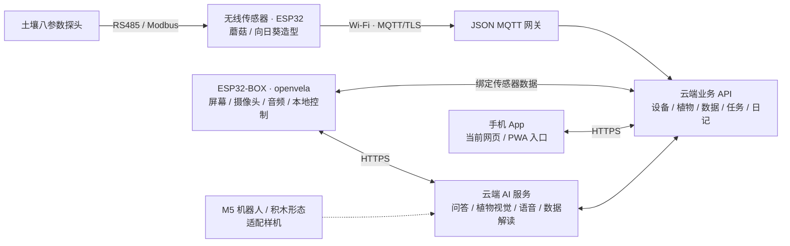

# 见壤 · 植小伴

**让植物状态看得见，让养护建议听得懂。**

植小伴是一套面向家庭养植、亲子陪伴和植物观察的智能养植系统：用无线传感器感知土壤，用摄像头观察植物，用自然语音把数据和养护建议讲给使用者听，并把观察结果连接到任务与成长日记。

参赛队伍：**叶绿体智能（北京见壤智能科技有限公司）**  
赛道：**AI 硬件产品创新**｜设备系统：**openvela / NuttX**｜BOX 固件：**v1.3.239**  
源码整理日期：2026-11-04

[BOX 运行指南](docs/box/运行指南.md) · [无线传感器运行指南](docs/soil-node/运行指南.md) · [云端与手机网页](server/README.md) · [版本与实测](docs/box/版本与验证.md) · [AI Coding 日志](logs/README.md)

## 产品与交互

### 一个会交流的养植伙伴

ESP32-BOX 装入可爱的豌豆外壳，摄像头可以前后转动，既能观察植物，也能朝向使用者。首页、语音页和更多页采用统一的“小伴”角色与卡片入口，豌豆表情随待机、收听、思考、播报切换。

| 能力 | 当前实现 |
| --- | --- |
| 语音交流 | 说“你好，小伴”唤醒，再询问养护问题或发出控制指令；支持屏幕操作 |
| 本地常用控制 | MultiNet5 Q8 中文小模型优先处理打开相机、拍照、返回、查看状态、成长日记等命令，未可靠命中时回退云端 |
| 植物拍照体检 | 约 12 FPS 本地预览、JPEG 拍照、云端视觉分析，展示品种判断、健康状态和养护建议 |
| 土壤状态解读 | 展示绑定无线节点的八参数读数与采集时间，支持语音查询和解释 |
| 养护记录 | 保存植物观察结果，查看成长日记与养护任务，形成持续观察的使用过程 |
| 语音与界面反馈 | 普通云端语音加本地柔化；相机识别等待提示、动态表情和新版配网键盘 |

### 无线传感器可以独立使用

无线传感器采用 **ESP32 + 土壤八参数传感器**，读取温度、水分、EC、pH、盐分、氮、磷、钾，通过 Wi-Fi 与 MQTT/TLS 上云。蘑菇和向日葵两款外观兼顾采集与花盆装饰；用户也可通过手机网页/PWA 查看数据，不必始终搭配 BOX。

采集节点独立负责 RS485/Modbus 探头和省电调度，BOX 通过云端绑定读取数据，两者不共用摄像头引脚。节点上报周期与 BOX 的云端拉取周期分别配置；当前 BOX 每 300 秒拉取一次，界面中的时间用于判断读数是否过期。

### 多形态探索

除豌豆外壳 ESP32-BOX 外，团队已展示 M5Stack 桌面机器人及积木小车形态，探索舵机视角、语音互动和搭建玩法。**本次完整整理与构建验证针对 BOX、独立无线节点和服务器；本仓未提供经同等验证的 M5 完整固件复现入口。**

“见壤智慧养植大脑”是后续研发方向：结合大模型、Agent、植物生长机理和专家研究，逐步验证种植决策与教育场景。相关设想与当前已验证的设备控制、植物体检分别说明。

## 端云协同架构



设备端负责界面、外设、相机预览和常用语音控制；云端负责开放问答、植物识图、语音合成、数据管理和多端共享。服务器包含主业务 API、独立 BOX AI 服务、JSON 土壤网关、手机网页/PWA 与管理台，部署关系见 [服务器说明](server/README.md)。

## 源码导航

| 目录 | 内容与入口 |
| --- | --- |
| [app/plant-companion](app/plant-companion/README.md) | BOX v1.3.239 应用、UI、摄像头、语音与必要第三方依赖 |
| [board/box](board/box/configs/contest_v239/defconfig) | BOX 完整构建配置 |
| [patches/box](patches/box/baselines.json) | 固定 SDK 参考提交、底层补丁及文件校验值 |
| [tools/box](tools/box/prepare.py) | SDK 预检、构建和实际分区校验烧录工具 |
| [docs/box](docs/box/运行指南.md) | BOX 运行、验证及提交说明 |
| [app/soil-node](app/soil-node/README.md) | 独立无线土壤节点应用 |
| [docs/soil-node](docs/soil-node/运行指南.md) | 节点接线、编译、配网、协议与验证范围 |
| [server](server/README.md) | 主 API、BOX AI、手机网页/PWA、管理台和 JSON 网关 |
| [mobile/plant_android](mobile/plant_android) | 既有 Android 原生工程，未与本次 PWA 同步重做 |
| [logs](logs/README.md) | AI Coding 会话、来源与人工导出范围说明 |
| [NOTICE](NOTICE) / [licenses](licenses) | 模型、静态库、字体和其他依赖的来源及许可 |

根目录 [contest2026_053_yelvtizhineng.xml](contest2026_053_yelvtizhineng.xml) 保留官方工作区入口，并映射 BOX 应用、`contest_v239` 板级配置和无线节点；[soil-node.xml](soil-node.xml) 用于独立土壤节点工作区。

## 获取与运行

```bash
git clone -b dev-ai-contest-2026 \
  https://github.com/open-vela/contest2026_053_yelvtizhineng.git
cd contest2026_053_yelvtizhineng
```

按目标模块选择指南，分别建立设备 SDK 和服务器环境：

| 目标 | 运行入口 | 需自行准备 |
| --- | --- | --- |
| ESP32-BOX | [BOX 运行指南](docs/box/运行指南.md) | Linux 构建环境、固定 SDK 参考版本、ESP32-S3 工具链、匹配分区的设备及网络配置 |
| 无线土壤传感器 | [节点运行指南](docs/soil-node/运行指南.md) | 独立 ESP32 工作区、RS485 探头、有效 MQTT/TLS 凭据 |
| 云端与手机网页 | [服务器入口](server/README.md)、[部署指南](docs/server/部署指南.md) | Python 环境、自己的数据库与模型配置；主业务 API 支持本地 mock 演示 |

BOX 已验证的编译流程依赖同事 DVP 固定参考提交及仓内增量补丁。按指南建立 `nuttx/`、`apps/` 和 `contest/` 后，在该 SDK 根目录执行：

```bash
python3 contest/tools/box/prepare.py . --check
bash contest/tools/box/build.sh .
```

构建产物为 `nuttx/nuttx.bin`。本版本镜像超过旧 2 MB 应用槽，使用 [分区校验烧录工具](tools/box/flash.py) 和指南中的匹配布局；历史双槽命令不适用于 v1.3.239。BOX 与无线节点的芯片、配置和烧录地址不同，应分别使用对应指南。

源码中的 Wi-Fi 工厂默认值与 API Key 已清空，不包含线上设备令牌、实际绑定、用户数据库或运行环境文件。使用自己的服务部署，或完成获授权的云端注册与绑定。具体配置位置见各模块指南。

## 真机演示与验证

本轮 BOX 连续演示覆盖：**唤醒 → 养护问答 → 打开相机 → 拍照体检 → 保存观察 → 返回首页 → 土壤状态与解读 → 成长日记 → 结束交流**。

| 已记录验证 | 范围 |
| --- | --- |
| BOX 真机演示 | v1.3.239；一次植物体检返回绿萝，快门至识图结果约 4.47 秒；属于当次样本，时延受网络与模型影响 |
| 公开源码独立构建 | 镜像 4,188,800 字节，启动堆 11,360 字节；261 个编译输入与公开文件一致 |
| 服务器源码自测 | 33 项测试、6 项 JavaScript 语法检查通过；未以此替代真实公网部署或硬件端到端测试 |
| 开发日志 | 本次 BOX 补充 645 条选定会话的用户可见真实对话，通过官方日志格式校验 |

证据与限制：[BOX 版本与验证](docs/box/版本与验证.md)、[构建记录](docs/box/evidence/public_build.json)、[无线节点提交检查](docs/soil-node/提交检查.md)、[服务器来源与验证](docs/server/来源与验证.md)。公开配置重编译镜像未在本次源码整理中重新刷入设备，历史真机演示与公开构建结果分别记录。

## AI Coding 与提交说明

团队借助 AI 完成需求拆解、界面与协议设计、驱动排查、本地语音控制、联调、真机回归和文档整理；人工负责硬件接线、现场配合、交互验收与方案取舍。开发日志保留真实来源、原始时间戳和导出限制，不以整理摘要替代原始会话。

本次 BOX 日志仅导出用户可见对话，开发时未触发官方工作区自动采集闸门，故明确标记为人工选择并脱敏的导出；既有日志沿用各自来源说明。见 [日志总览](logs/README.md)与[BOX 日志补充](logs/BOX_V239_20261104.md)。

仓库通过 fork → PR 更新。官方 SDK 公共仓改动的独立 PR/合入、ai_agent 与自定义 Skill 的形式化验收，以及一次完整联网 `repo sync` 仍需分别核对，见 [BOX 提交检查](docs/box/提交检查.md)。整理依据见官方 [参赛代码提交指南](https://github.com/open-vela/docs/blob/dev-ai-contest-2026/zh-cn/contest_2026/code_submission_guide.md)。

## 当前边界

- 常用控制优先在设备端处理；自由问答、识图、语音合成和云端数据读取仍依赖网络，噪声与不同说法会影响识别。
- 当前未启用播报中插话打断，等待小伴说完后再发出下一条指令。
- 当前 BOX 未连接实际浇水执行机构；任务确认、数据解读和观察记录不等于已经自动完成水肥操作。
- 模型输出的植物品种、健康分与建议用于养植参考；单次演示不作为识别准确率或固定时延承诺。
- M5 形态、教育应用与 Agent 种植决策按各自实际研发和验证进度说明。

## 许可与致谢

项目原创部分采用 [Apache-2.0](LICENSE)。ESP-SR、ESP-DSP、newlib、cJSON、Noto 字体及 OpenMoji 衍生字形等依赖保留各自许可和使用限制，详见 [NOTICE](NOTICE) 与 [licenses](licenses)。

感谢 openvela 社区、同事相机分支贡献者和开源依赖维护者。
